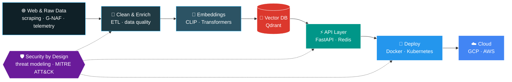
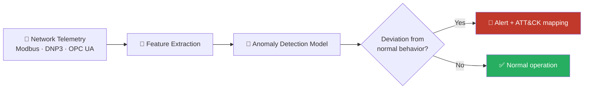
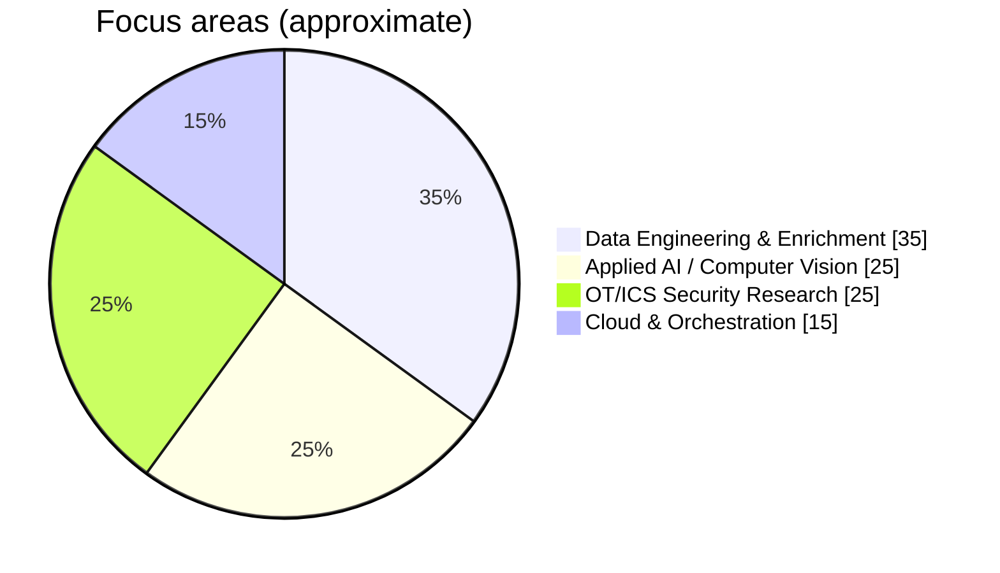
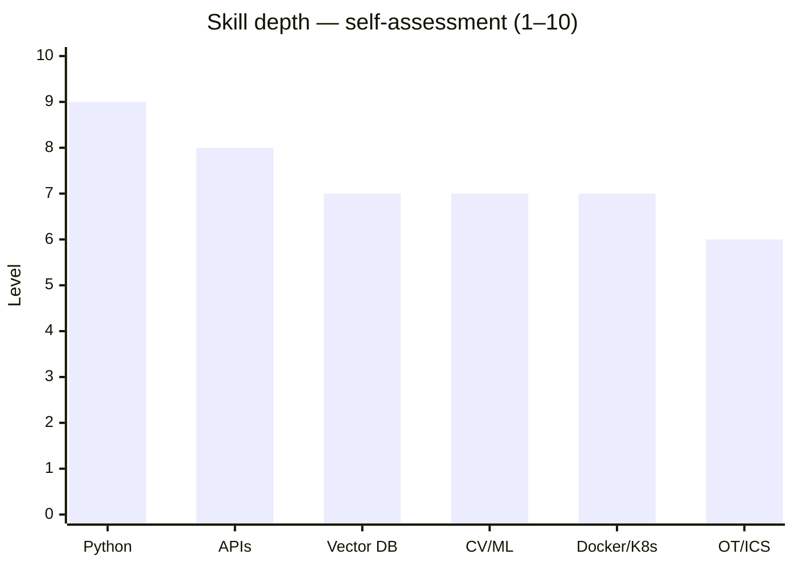
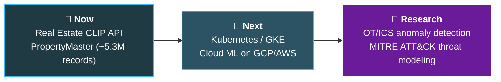

<div align="center">

<h1>LE HOANG KHOI</h1>

<h3>Data Engineer · AI/ML Builder · OT/ICS Security Researcher</h3>

<a href="https://github.com/noteart13">
  
</a>

<br/>

<b>
<a href="https://github.com/noteart13">🐙 GitHub</a> ·
<a href="https://www.linkedin.com/in/khoi-le-hoang-khoi-167776232">💼 LinkedIn</a> ·
<a href="mailto:lehoangkhoi070705@gmail.com">📧 Email</a>
</b>

<br/><br/>

🇻🇳 Based in Vietnam &nbsp;·&nbsp; 🎯 Focus: Data × AI × Security &nbsp;·&nbsp; 🤝 Open to collaboration

<br/><br/>


<br/>

*Building reliable data systems and practical AI — with security engineered in from day one.*

</div>

---

## 👋 About me

I'm **Le Hoang Khoi**, a data engineer from Vietnam working at the intersection of **data platforms 🗄️, machine learning 🧠, and cybersecurity 🛡️**.

I enjoy taking ideas from a prototype to a usable system: collecting and enriching data, building intelligent retrieval APIs, deploying services, and considering security throughout the engineering process.

| | |
| :-- | :-- |
| 🔭 **Currently building** | AI-enhanced search, data enrichment, and vector-based retrieval |
| 🔬 **Researching** | AI-driven anomaly detection for **industrial OT/ICS environments** |
| 🌱 **Exploring** | Kubernetes/GKE orchestration and cloud ML workflows on GCP/AWS |
| 🧭 **Mindset** | *Understand the system. Challenge its assumptions. Rebuild it securely.* |

```text
┌──────────────────────────────────────────────────────────┐
│  $ whoami                                                │
│  khoi · data-engineer · ai-builder · ot-security         │
│                                                          │
│  $ cat mission.txt                                       │
│  Understand → Challenge → Rebuild securely               │
└──────────────────────────────────────────────────────────┘
```

---

## 🗺️ How I work — from raw data to secure intelligence



---

## 🧩 Selected work

<table>
<tr>
<td width="50%" valign="top">

### 🏘️ [Real Estate CLIP API](https://github.com/noteart13/Real-estate-api)

An AI-powered property intelligence API combining web data collection, **CLIP image embeddings**, and **semantic retrieval**.

`Python` `FastAPI` `PyTorch` `Redis` `Docker` `Kubernetes`

[**Explore source code →**](https://github.com/noteart13/Real-estate-api)

</td>
<td width="50%" valign="top">

### 🗃️ PropertyMaster — Data Enrichment

Working with **~5.3 million Australian address records** and **Qdrant** to enrich missing fields while preserving existing values.

`Data Quality` `Qdrant` `ETL Pipeline` `G-NAF`

*🚧 Ongoing project · repository not public*

</td>
</tr>
<tr>
<td colspan="2" valign="top">

### 🛡️ AI for Industrial Cybersecurity

Research direction: **machine learning-based anomaly detection** for OT/ICS and SCADA environments, connecting network telemetry, threat modeling, and secure system design.

`Anomaly Detection (ML)` `Industrial Networks` `MITRE ATT&CK` `Security by Design`

*🔬 Research in progress*



</td>
</tr>
</table>

---

## 🛠️ Technology stack

<div align="center">


</div>

| 🗄️ Data & Backend | 🧠 AI & Computer Vision | ☁️ Cloud & DevOps | 🔐 Security & Research |
| :-- | :-- | :-- | :-- |
| `Python` | `PyTorch` | `Docker` | `Linux` |
| `FastAPI` | `CLIP` | `Kubernetes` | `Wireshark` |
| `Qdrant` | `Computer Vision` | `Google Cloud` | `Nmap` |
| `Redis` | `Transformers` | `AWS` | `OT / ICS` |
| `MongoDB` | | `Git` | |

---

## 📊 Where my energy goes





---

## 🎯 What I'm focused on

| 🏗️ Build | 🔭 Explore |
| :--- | :--- |
| Scalable data enrichment & quality checks | Efficient vector retrieval and embedding workflows |
| Reliable Python APIs and backend services | Cloud-native ML pipelines and orchestration |
| Practical computer vision systems | Threat-informed anomaly detection for OT/ICS |

### 🧭 Roadmap



---

## 📈 GitHub stats

<div align="center">


</div>

---

## 🤝 Let's connect

I'm interested in conversations about **data engineering, applied AI, cloud infrastructure, and resilient industrial systems**.

- 💼 **LinkedIn:** [linkedin.com/in/khoi-le-hoang-khoi-167776232](https://www.linkedin.com/in/khoi-le-hoang-khoi-167776232)
- 📧 **Email:** [lehoangkhoi070705@gmail.com](mailto:lehoangkhoi070705@gmail.com)
- 🐙 **GitHub:** [github.com/noteart13](https://github.com/noteart13)

<div align="center">

<br/>

<sub>Thoughtful engineering · Useful AI · Secure systems</sub>

</div>
